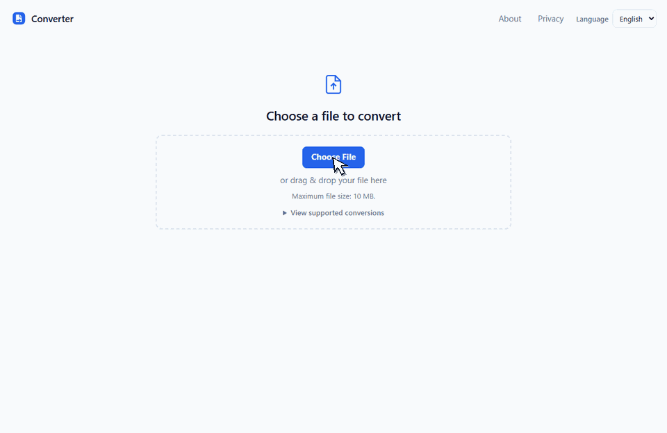
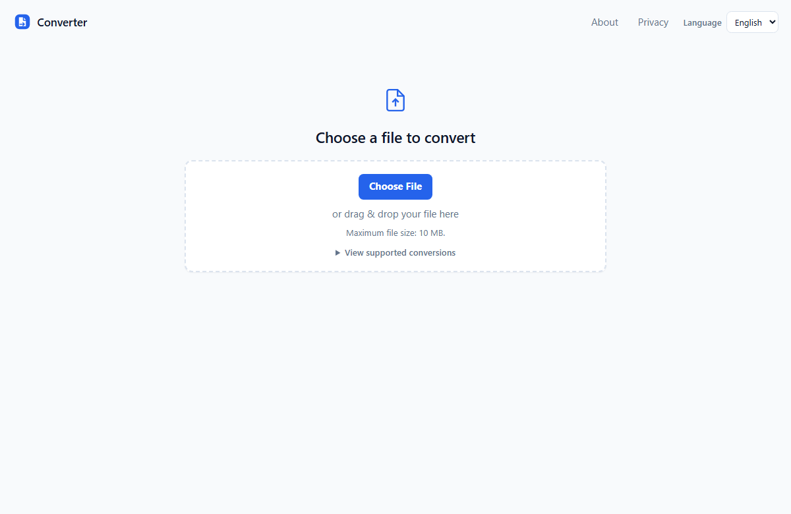
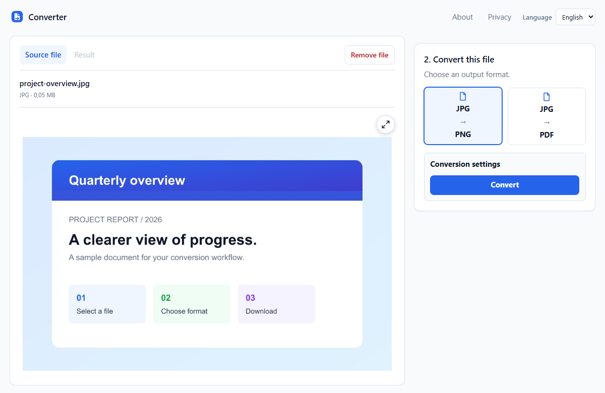
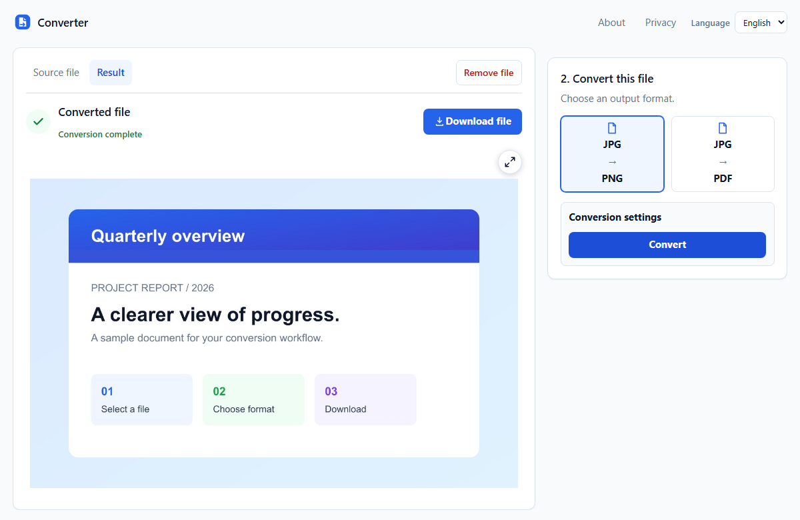
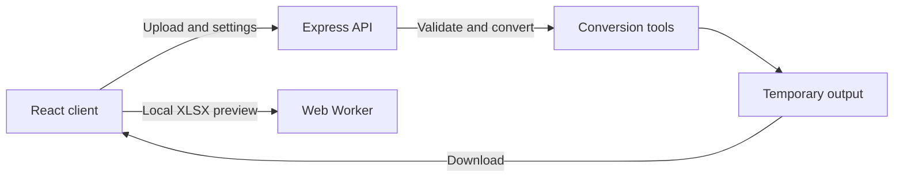

# Online File Converter

[](https://github.com/Jaroslaw-Baumgart/OnlineConverter-app/actions/workflows/ci.yml)

A file converter built with React, TypeScript, and Express. Choose a document or
image, preview it, configure the output, and download the result. The app runs
locally; it is not a hosted conversion service. Files are limited to 10 MB.

## See it in action

Choose a file, select an output format, and download the converted result.
The example below shows a JPG-to-PNG conversion through the local server.



<details>
<summary>More screenshots</summary>

**Choose a file**



**Preview and conversion settings**



**Conversion result**



</details>

## Features

- Convert common document and image formats, with a choice of output settings.
- Preview images, PDF, TXT, CSV, DOCX, XLSX, and PPTX files before conversion.
- Choose a single XLSX sheet or preview all sheets.
- Preview and download results, including ZIP downloads for multi-file conversions.
- Expand previews and use the conversion workflow with a keyboard.
- Switch between English and Polish; the chosen language is saved locally.

## How it works



The client handles previews and sends the selected file and settings to the API.
The server validates the request and uses the appropriate conversion tool. The
client downloads the result for its preview and can package multiple files into a
ZIP archive.

A few implementation details:

- XLSX previews use a cancellable Web Worker when available, with a fallback to
  the main thread. Preview rows, columns, and sheets are limited.
- The server checks file types and enforces limits on uploads, archive contents,
  page counts, and concurrent conversions.
- Uploads and generated files are temporary. Result previews use the downloaded
  files, so they remain available after server cleanup.

## Supported conversions

| Source | Target |
| --- | --- |
| PDF | JPG, TXT |
| JPG | PNG, PDF |
| PNG | JPG |
| TXT | PDF |
| CSV | PDF |
| DOCX | PDF |
| XLSX | PDF |
| PPTX | PDF |

DOCX, XLSX, and PPTX conversions use LibreOffice. XLSX conversion can use one
selected sheet or every sheet, together with page settings.

## Tech stack

- **Client:** React, Vite, TypeScript, React Router, React Hook Form, Zod,
  i18next, CSS Modules
- **Server:** Express, TypeScript, Multer, Zod
- **File processing:** Sharp, PDFKit, Papa Parse, SheetJS, docx-preview,
  Office Kit, LibreOffice, pdf-poppler
- **Testing:** Vitest, Testing Library, MSW, Supertest, Playwright
- **CI:** GitHub Actions

## Requirements

- Node.js 22 or newer and npm
- LibreOffice for DOCX, XLSX, and PPTX to PDF conversion
- Poppler on `PATH` on Linux/macOS (`pdfinfo`, `pdftocairo`, `pdftotext`)

The default server configuration expects portable LibreOffice here:

```text
tools/libreoffice/program/soffice.com
```

The repository includes an empty `tools/` directory. Copy a portable
LibreOffice build into that directory before using Office-to-PDF conversions.
Its contents are ignored by Git, so converter binaries are never committed.
Alternatively, set the `LIBRE_OFFICE_PATH` environment variable to a local
executable (for example `/usr/bin/libreoffice` on Linux). Windows uses Poppler
binaries bundled by `pdf-poppler`; `POPPLER_BIN_DIR` can override their location.
LibreOffice and Poppler processes have a two-minute timeout.

## Setup

Install dependencies:

```bash
npm ci
npm ci --prefix client
npm ci --prefix server
```

Start the client and server together:

```bash
npm run dev
```

- Client: `http://localhost:5173`
- Server: `http://localhost:5000`

The API binds to `127.0.0.1`. CORS permits the local Vite development and preview
origins; set `CLIENT_ORIGIN` to allow a different frontend origin.

## Processing limits

Uploads are limited to 10 MB. Other limits depend on the conversion and preview type.

<details>
<summary>All processing limits</summary>

| Operation | Limit |
| --- | --- |
| Upload | 10 MB per file |
| Image conversion (JPG/PNG and JPG to PDF) | 40 million pixels, checked before conversion |
| PDF inputs and TXT/CSV PDF outputs | 100 pages |
| Office archive processing on the server | 50 MB of decompressed data and 2,000 entries |
| CSV conversion | 10,000 rows, 50 columns, 50,000 characters per cell or header |
| XLSX preview archive | 50 MB of decompressed data and 500 entries |
| XLSX preview table | 20 sheets, 50 columns, first 100 rows per sheet; up to 100,000 cells |
| Downloaded conversion results | 100 MB total per conversion |

The server admits at most two requests to upload, validation and conversion at
a time. LibreOffice jobs run one at a time. Removing a file cancels browser
requests and XLSX preview parsing; server processing already started may
continue until completion or its timeout.

</details>

## Quality checks

```bash
npm run lint
npm run typecheck
npm run test
npm run build
npm run check
npm run test:e2e
```

`check` runs linting, type checks, unit and integration tests, and a production
build. `test:e2e` starts the development servers when needed and runs Playwright
in Chromium. The E2E scenarios cover real conversions, ZIP downloads, error
handling, and the layout on a narrow viewport. Install the browser before
running E2E tests:

```bash
npx playwright install chromium
```

Some tests also require the external tools listed above. GitHub Actions runs
both checks for pushes and pull requests to `main`.

On Windows PowerShell, use `npm.cmd` and `npx.cmd` if script execution policy
blocks `npm.ps1`. To run tests for each application separately:

```powershell
npm.cmd run test:run --prefix client
npm.cmd run test:run --prefix server
```

## File handling and privacy

Source uploads are deleted after the request finishes. Generated files are
available temporarily for download; a later upload removes results older than
30 minutes. Temporary upload and output folders are also cleared when the
server stops normally.

Only upload files you are allowed to process. For sensitive documents, run the
application and server on your own computer. The in-app Privacy page explains
the same handling in the user interface.

## Project structure

```text
client/       React application
server/       Express API and conversion logic
shared/       API response types and backend error codes used by both applications
e2e/          Playwright scenarios and deterministic fixtures
tools/        Local LibreOffice location; binaries are ignored by Git
docs/         Personal documentation; ignored by Git
```

## License and third-party software

The project is licensed under MIT. LibreOffice is distributed separately under
its own licenses. If the application is later packaged with LibreOffice, the
release must include the required third-party notices.
